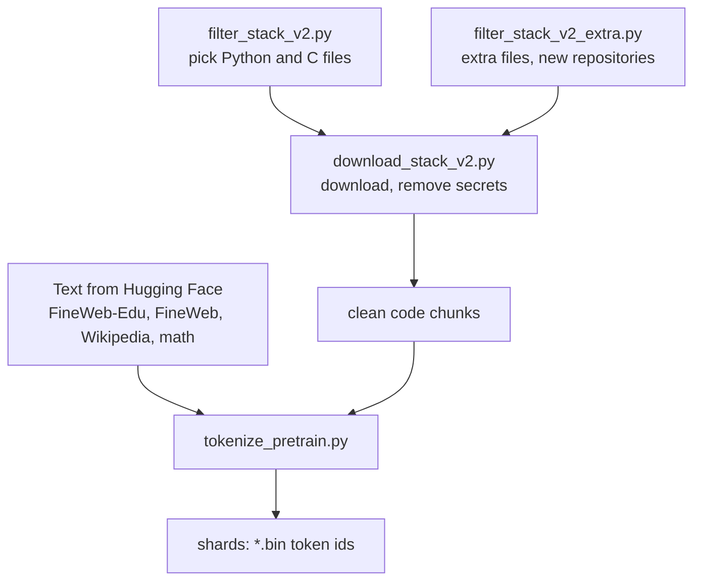

<p align="center">
  
</p>

# Nexus Data Pipeline

Turns raw datasets into the token shards Nexus trains on, using the Nexus tokenizer.
Web, math and Wikipedia text is streamed from Hugging Face. Code comes from The Stack v2,
which only stores file IDs, so it is selected, downloaded and cleaned first.

## Pipeline



## Data mix

Target for about 16B tokens. Each source gets its own shards, so training can mix them by weight.

| Source | Target tokens | Share |
|--------|--------------:|------:|
| FineWeb-Edu | 6.85B | 42.8% |
| FineWeb | 4.16B | 26% |
| Python | 2.47B | 15.4% |
| Math | 1.28B | 8% |
| Wikipedia | 0.80B | 5% |
| C | 0.44B | 2.75% |

The data is English-only. Tool-use data is left out of pretraining and used later in fine-tuning.

## How the code data was built

1. `filter_stack_v2.py` picks files labelled permissive, 200 bytes to 100 KB, at most 50 per repository.
2. `download_stack_v2.py` downloads them, drops files that contain secrets (API keys, tokens, private keys),
   drops data dumps and minified files, and masks email addresses.
3. A license whitelist keeps only files whose licenses are all on an approved list (MIT, Apache-2.0, BSD,
   ISC and similar, in `pretrain_dataset.json`). The "permissive" label alone also let GPL and unknown
   licenses through. This removed about 6.4% of the files.
4. After the whitelist, Python was about 9% short of its token target. Instead of repeating data,
   `filter_stack_v2_extra.py` picked more files from new repositories (different seed), and they were
   downloaded and cleaned the same way.

## Output

Shards are flat files of token ids (2 bytes each), about 100M tokens each. Each document is stored as
`<bos> text <eos>`.

```
shards/
├── fineweb_edu_0000.bin
├── python_0000.bin
└── ...
```

## Files

| File | Purpose |
|------|---------|
| `pretrain_dataset.json` | Sources, token targets, shard size, license whitelist |
| `filter_stack_v2.py` | Picks Python and C files from The Stack v2 |
| `filter_stack_v2_extra.py` | Picks extra files from new repositories |
| `download_stack_v2.py` | Downloads and cleans the code |
| `tokenize_pretrain.py` | Tokenizes every source into shards |

## Rebuild

The raw data and the shards are not stored in the repository because of their size.

```
python data_prep/filter_stack_v2.py
python data_prep/download_stack_v2.py
python data_prep/filter_stack_v2_extra.py      # if the token's target is still not reached !
python data_prep/download_stack_v2.py          # for the extra manifest and folder
python data_prep/tokenize_pretrain.py
```